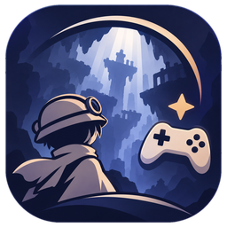

<p align="center">
  
</p>

<h1 align="center">AbyssHub</h1>

<p align="center">
  Veja <b>quanto tempo você joga</b> cada jogo no celular e na <b>Steam</b> e na <b>PlayStation</b> e dispute com outros jogadores no <b>Leaderboard</b>.
</p>

<p align="center">
  <a href="../../releases/latest"></a>
  
  
  <a href="LICENSE"></a>
</p>

O AbyssHub faz parte do conjunto **Abyss**, junto com o [AbyssSub](https://github.com/fbio3/AbyssSub).

## Sumário

- [Recursos](#recursos)
- [Baixar e instalar](#baixar-e-instalar)
- [Permissões](#permissões)
- [Privacidade](#privacidade)
- [Perguntas frequentes](#perguntas-frequentes)
- [Para desenvolvedores](#para-desenvolvedores)
- [Licença](#licença)

## Recursos

O app tem quatro abas: **Início · Jogos · Leaderboard · Histórico**.

### Início

- Tempo total jogado **hoje**, nos **últimos 7 dias**, nos **últimos 30 dias** ou **desde sempre**
- Comparação com o período anterior (ex.: *+25%*) e média por dia
- Gráfico **por jogo**, gráfico dos **últimos 7 dias** (toque num dia para ver os detalhes) e os **mais jogados**
- Aviso de **"Jogando agora"** quando um jogo está aberto

### Jogos

- Ranking dos seus jogos com o tempo, o número de sessões e quando você jogou por último
- Tela de cada jogo com total, média por sessão, sessão mais longa, gráfico da semana e todas as sessões
- Os jogos são reconhecidos sozinhos; dá para marcar ou desmarcar qualquer app como jogo
- O mesmo jogo instalado de lojas diferentes (ex.: Play Store e Galaxy Store) conta como um só
- **Jogos da Steam** (PC) junto com os do celular: conecte a sua conta nas configurações
- **Jogos da PlayStation** (PS4 e PS5): conecte com o seu ID online, sem precisar de senha

### Leaderboard

- Veja **quem mais jogou**, com foto, nome, jogo e tempo
- Três jeitos de ver: **por pessoa** (com o jogo que ela mais jogou), **por pessoa + jogo** e **por jogo**
- Períodos: **Hoje**, **Semana** (padrão), **Mês** e **Tudo**
- Filtro de plataforma: **Todas**, **Mobile**, **Steam** ou **PSN**, com um símbolo mostrando de onde é cada jogo

### Placar e Eventos

- **Placar**: quem ganhou cada dia, semana (segunda a domingo) ou mês, do mais recente para trás, ou de uma data que você escolher
- **Eventos**: desafios com recompensas, com quem está na frente ao vivo e os vencedores no final
- Notificação quando um evento começa e quando termina
- Pódio com os 3 primeiros e a sua posição destacada
- **Atualiza sozinho a cada minuto**
- Entre com **Google** ou com **e-mail e senha** (e dá para conectar os dois na mesma conta); só aparece no ranking quem entrou
- Escolha o **nome** e a **foto** que aparecem no ranking

### Histórico

- Todas as suas sessões dos últimos 30 dias, separadas por dia, com horário de início e fim

### E também

- **Tema claro e escuro** (segue o celular ou você escolhe)
- Animações suaves, que podem ser desligadas para economizar bateria
- Rolagem com impulso, como nos outros apps do celular
- **Atualização automática**: o app avisa quando sai uma versão nova, baixa e instala sem você precisar entrar no GitHub

## Baixar e instalar

1. Abra a página da [versão mais recente](../../releases/latest) no celular.
2. Baixe o arquivo **AbyssHub.apk**.
3. Abra o arquivo e toque em **Instalar**. Se o Android pedir, permita **instalar apps desconhecidos** para o navegador.
4. Abra o AbyssHub e libere o **Acesso ao uso** (o app mostra o caminho).

Depois disso, as próximas versões chegam pelo próprio app.

> Funciona em celulares com **Android 8.0 ou mais novo** e processador de 64 bits (quase todos os celulares atuais).

## Permissões

| Permissão | Para quê |
|---|---|
| **Acesso ao uso** | Saber quando cada app foi aberto e fechado. É assim que o tempo de jogo é contado. Você libera nas configurações do Android. |
| **Ver apps instalados** | Mostrar o nome e o ícone de cada jogo e reconhecer quais apps são jogos. |
| **Internet** | Leaderboard, fotos, horas da Steam e da PlayStation (se você conectar) e procurar atualizações. |
| **Instalar apps** | Instalar as atualizações do próprio AbyssHub (o Android sempre pede a sua confirmação). |
| **Notificações** | Avisar quando um evento começa ou termina. Você pode negar ou desligar quando quiser. |

## Privacidade

- O seu histórico de uso **fica no seu celular**. O AbyssHub não envia a lista de apps que você usa.
- **Só se você entrar no Leaderboard**, o app envia o **nome** e a **foto** que você escolheu e o **tempo dos apps que contam como jogo**. Os outros jogadores veem essas informações no ranking.
- Nas configurações você pode **sair da conta** ou **sair e apagar seus dados do Leaderboard** a qualquer momento.
- O app não tem anúncios e não usa rastreadores.

## Perguntas frequentes

**Como conecto a Steam?**
Em Configurações > **Steam**, toque em **Conectar Steam**. O app pede duas coisas: o link do seu perfil da Steam e uma **chave da Steam Web API**, que você gera de graça em [steamcommunity.com/dev/apikey](https://steamcommunity.com/dev/apikey) (em "Nome de domínio" pode escrever qualquer coisa, como `abysshub`). Na Steam, deixe **Detalhes do jogo** como **Público** em Privacidade. A chave fica guardada só no seu celular e nunca vai para o Leaderboard.

**Como conecto a PlayStation?**
Em Configurações > **PlayStation**, toque em **Conectar PlayStation** e digite o seu ID online. O app mostra um código: cole no **"Sobre"** do seu perfil da PSN (pelo app PlayStation, pelo console ou pelo site), deixe a privacidade como **Qualquer pessoa** e toque em **Verificar**. Você não dá a sua senha para ninguém; depois de verificar, já pode apagar o código do "Sobre". Só jogos de PS4 e PS5 têm horas.

**Por que as horas da Steam e da PSN de hoje e da semana começam do zero?**
A Steam e a PSN só informam o total de horas de cada jogo, não quando você jogou. Por isso as horas que você já tinha contam em "Tudo", e Hoje, Semana e Mês contam o que você jogar a partir do dia em que conectou.

**Por que o tempo de um jogo não apareceu?**
O Android guarda o histórico de uso só por alguns dias. Abra o AbyssHub pelo menos uma vez por semana para nenhum tempo se perder. Se o app não reconheceu algo como jogo, marque em **Configurações > O que conta como jogo**.

**O app gasta bateria em segundo plano?**
Não. Ele não roda em segundo plano: o próprio Android anota o uso dos apps, e o AbyssHub só lê essas anotações quando você abre o app.

**Esqueci minha senha.**
Na tela de entrar com e-mail, toque em **Esqueci minha senha** e siga o link que chega no seu e-mail.

## Para desenvolvedores

O AbyssHub é feito em **Rust** com [egui](https://github.com/emilk/egui). Uma pequena parte em **Java** (pasta `android/`) cuida do que o Android exige: login, Firebase, imagens e instalação de atualizações.

```
src/                    app em Rust (telas, contagem do tempo, Leaderboard)
android/                projeto Gradle que monta o APK
firestore.rules         regras do banco de dados do Leaderboard
firestore.indexes.json  índices das buscas do Leaderboard
assets/                 ícone e fontes (Inter)
```

**Testar a interface no PC** (com dados de exemplo):

```
cargo run
```

**Gerar o APK** (Windows, com o Android Studio, SDK e NDK instalados):

```powershell
.\build-android.ps1            # gera APK\AbyssHub-release.apk
.\build-android.ps1 -Instalar   # gera e instala no celular conectado no USB
```

Para o login e o Leaderboard funcionarem, coloque o `google-services.json` do seu projeto Firebase em `android/app/` e publique as regras e os índices de `firestore.rules` e `firestore.indexes.json`. Sem ele, o app funciona normalmente, só sem o Leaderboard.

As versões oficiais são geradas pelo GitHub Actions: ao publicar uma Release, o APK é anexado sozinho e os apps já instalados oferecem a atualização.

## Licença

[MIT](LICENSE). As fontes Inter seguem a licença OFL (`assets/fontes/LICENCA-Inter.txt`).
